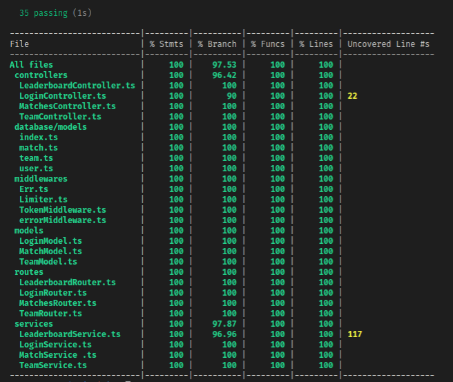

# Trybe Soccer Club


🇧🇷 [Leia em português](./README.pt-br.md)

REST API for a football championship standings app, written in **TypeScript** with **Express**, **Sequelize** and **MySQL**. It handles login with JWT, teams, matches and a leaderboard (overall, home and away). Built during the backend module of Trybe's Full Stack Web Development course; the frontend was provided by Trybe, and everything under `app/backend` is mine.

> **Note:** the app is not deployed (the free hosted database tier it used no longer exists). Run it locally with one Docker command, as shown below.



## Features

- Login with hashed passwords (bcrypt) and JWT authentication
- Teams and matches: list, filter by in-progress or finished, create, update score and finish a match
- Leaderboard computed from match results: overall, home and away
- Swagger documentation at `/api-docs`
- Security basics: Helmet, rate limiting and environment variables with dotenv
- Integration tests with Mocha, Chai and Sinon, with a coverage report from nyc

## Architecture

Object-oriented, layered **Model → Service → Controller** structure, with routers on top:

```
app/backend/src
├── routes/        # Express routers (Login, Teams, Matches, Leaderboard)
├── controllers/   # HTTP layer
├── services/      # business rules
├── database/      # Sequelize models, migrations and seeders
├── interfaces/    # TypeScript contracts for models and services
├── helpers/       # Bcrypt and JWT helpers
├── middlewares/   # token auth, rate limit and error handling
└── tests/         # integration tests
```

## Tech stack

TypeScript · Node.js · Express · Sequelize · MySQL · JWT · bcrypt · Docker and Docker Compose · Swagger · Helmet · Morgan · ESLint · Mocha, Chai, Sinon and nyc · Conventional Commits

## Running locally

Requirements: Docker and Docker Compose.

```bash
git clone https://github.com/IgorMarinhoArgollo/trybe-soccer-club.git
cd trybe-soccer-club
```

Create `app/backend/.env`:

```
JWT_SECRET=jwt_secret
APP_PORT=3001
DB_USER=root
DB_PASS=12345678
DB_HOST=localhost
DB_PORT=3306
```

Create `app/frontend/.env`:

```
SKIP_PREFLIGHT_CHECK=true
```

Start everything from the `app` folder:

```bash
cd app
docker-compose up
```

The app is then available at <http://localhost:3000>.

**Backend only:** go to `app/backend` and run `npm run dev`. The API runs at <http://localhost:3001> and the docs at <http://localhost:3001/api-docs/>.

## API

| Method | Route | Description | Auth |
|---|---|---|---|
| POST | `/login` | Returns a JWT | No |
| GET | `/login/validate` | Returns the user role from the token | Token |
| GET | `/teams` | Lists teams | No |
| GET | `/teams/:id` | Gets a team | No |
| GET | `/matches` | Lists matches | No |
| POST | `/matches` | Creates a match | Token |
| PATCH | `/matches/:id` | Updates a match score | No |
| PATCH | `/matches/:id/finish` | Finishes a match | No |
| GET | `/leaderboard` | Overall standings | No |
| GET | `/leaderboard/home` | Home standings | No |
| GET | `/leaderboard/away` | Away standings | No |

To get a token, send a `POST /login` with the seeded user:

```json
{ "email": "admin@admin.com", "password": "secret_admin" }
```

Then send it in the `Authorization` header of protected requests, as `Bearer <token>`.

## Tests

From `app/backend`:

```bash
npm test                 # run the tests
npm run test:coverage    # run the tests with a coverage report
```

Because these are integration tests, two spots (the JWT secret handling and the leaderboard sort function) are covered only indirectly, and the coverage report flags them with warnings.

## Author

**Igor Marinho Argollo** · [LinkedIn](https://www.linkedin.com/in/igormarinhoargollo/) · [Portfolio](https://igor-marinho.netlify.app/)

## License

MIT
