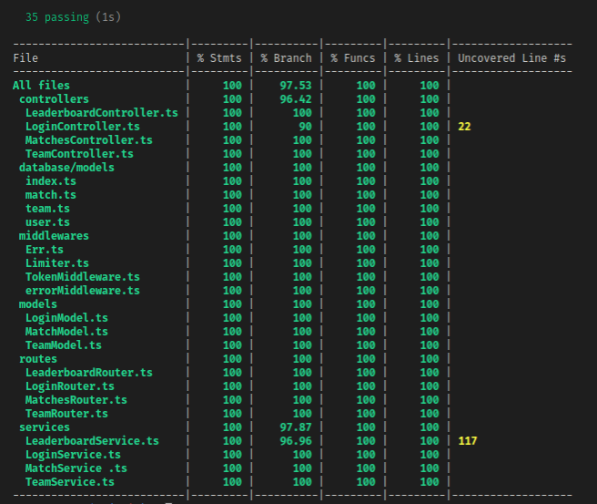

# Trybe Soccer Club


🇺🇸 [Read in English](./README.md)

API REST para uma aplicação de classificação de campeonato de futebol, escrita em **TypeScript** com **Express**, **Sequelize** e **MySQL**. Ela cuida de login com JWT, times, partidas e classificação (geral, mandante e visitante). Foi desenvolvida no módulo de backend do curso de Desenvolvimento Web Full Stack da Trybe; o frontend foi fornecido pela Trybe, e tudo em `app/backend` é meu.

> **Observação:** a aplicação não está publicada (o serviço gratuito de banco de dados que ela usava deixou de existir). Rode localmente com um comando Docker, como mostrado abaixo.



## Funcionalidades

- Login com senhas criptografadas (bcrypt) e autenticação via JWT
- Times e partidas: listagem, filtro por partidas em andamento ou finalizadas, criação, atualização de placar e finalização
- Classificação calculada a partir dos resultados: geral, mandante e visitante
- Documentação com Swagger em `/api-docs`
- Boas práticas de segurança: Helmet, rate limit e variáveis de ambiente com dotenv
- Testes de integração com Mocha, Chai e Sinon, com relatório de cobertura do nyc

## Arquitetura

Estrutura orientada a objetos em camadas **Model → Service → Controller**, com os roteadores na frente:

```
app/backend/src
├── routes/        # roteadores Express (Login, Teams, Matches, Leaderboard)
├── controllers/   # camada HTTP
├── services/      # regras de negócio
├── database/      # models, migrations e seeders do Sequelize
├── interfaces/    # contratos TypeScript de models e services
├── helpers/       # helpers de Bcrypt e JWT
├── middlewares/   # autenticação por token, rate limit e tratamento de erros
└── tests/         # testes de integração
```

## Tecnologias

TypeScript · Node.js · Express · Sequelize · MySQL · JWT · bcrypt · Docker e Docker Compose · Swagger · Helmet · Morgan · ESLint · Mocha, Chai, Sinon e nyc · Conventional Commits

## Como rodar

Requisitos: Docker e Docker Compose.

```bash
git clone https://github.com/IgorMarinhoArgollo/trybe-soccer-club.git
cd trybe-soccer-club
```

Crie `app/backend/.env`:

```
JWT_SECRET=jwt_secret
APP_PORT=3001
DB_USER=root
DB_PASS=12345678
DB_HOST=localhost
DB_PORT=3306
```

Crie `app/frontend/.env`:

```
SKIP_PREFLIGHT_CHECK=true
```

Suba tudo a partir da pasta `app`:

```bash
cd app
docker-compose up
```

A aplicação ficará disponível em <http://localhost:3000>.

**Somente o backend:** entre em `app/backend` e rode `npm run dev`. A API ficará em <http://localhost:3001> e a documentação em <http://localhost:3001/api-docs/>.

## API

| Método | Rota | Descrição | Autenticação |
|---|---|---|---|
| POST | `/login` | Retorna um JWT | Não |
| GET | `/login/validate` | Retorna o perfil do usuário a partir do token | Token |
| GET | `/teams` | Lista os times | Não |
| GET | `/teams/:id` | Busca um time | Não |
| GET | `/matches` | Lista as partidas | Não |
| POST | `/matches` | Cria uma partida | Token |
| PATCH | `/matches/:id` | Atualiza o placar de uma partida | Não |
| PATCH | `/matches/:id/finish` | Finaliza uma partida | Não |
| GET | `/leaderboard` | Classificação geral | Não |
| GET | `/leaderboard/home` | Classificação como mandante | Não |
| GET | `/leaderboard/away` | Classificação como visitante | Não |

Para obter um token, envie um `POST /login` com o usuário criado pelo seed:

```json
{ "email": "admin@admin.com", "password": "secret_admin" }
```

Depois, envie o token no cabeçalho `Authorization` das requisições protegidas, no formato `Bearer <token>`.

## Testes

A partir de `app/backend`:

```bash
npm test                 # roda os testes
npm run test:coverage    # roda os testes com relatório de cobertura
```

Como são testes de integração, dois pontos (o tratamento do segredo do JWT e a função que ordena a classificação) são cobertos apenas indiretamente, e o relatório de cobertura os sinaliza com avisos.

## Autor

**Igor Marinho Argollo** · [LinkedIn](https://www.linkedin.com/in/igormarinhoargollo/) · [Portfólio](https://igor-marinho.netlify.app/)

## Licença

MIT
